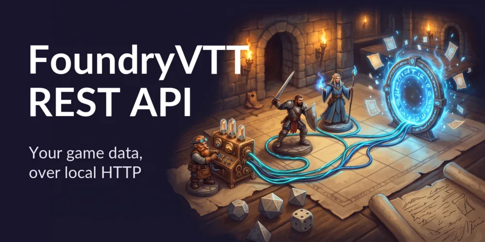

# Foundry Local REST API



[](LICENSE)
[](https://github.com/laurigates/foundryvtt-local-rest-api/actions/workflows/test.yml)
[](https://github.com/laurigates/foundryvtt-local-rest-api/releases)

A purely local REST API for FoundryVTT: HTTP endpoints for actors, items, scenes, dice rolling and world data, with no third-party relay service. A FoundryVTT module answers requests from inside Foundry, and a small Node.js bridge server exposes them over HTTP with API-key authentication. Game data stays on your network.

## Quick Start

1. In FoundryVTT, go to **Setup** → **Add-on Modules** → **Install Module** and paste the manifest URL:
   ```
   https://github.com/laurigates/foundryvtt-local-rest-api/releases/latest/download/module.json
   ```
2. Enable the module in your world, then turn on **Enable REST API** in the module settings and copy the generated API key.
3. Start the bridge server and call it:

```bash
cd bridge-server && npm ci && API_KEY=<key> npm start
curl -H "x-api-key: <key>" http://localhost:3030/api/status
```

The full setup, with the bridge-server environment variables, is in [Usage](docs/usage.md#installation) and [Configuration](docs/configuration.md).

## Documentation

| Page | Contents |
|------|----------|
| [Overview](docs/overview.md) | Two-component architecture and the privacy model |
| [Usage](docs/usage.md) | Installation, endpoints, integration examples, troubleshooting |
| [Configuration](docs/configuration.md) | Module settings and bridge-server environment variables |
| [Development](docs/development.md) | Running the tests, coverage, support |
| [Architecture](docs/ARCHITECTURE.md) | Technical design and why it needs two components |
| [Decisions](docs/adrs/README.md) | Architecture decision records |
| [Installation guide](docs/INSTALLATION.md) | Step-by-step setup |
| [Bridge server](bridge-server/README.md) | Bridge-server documentation |

## License

[MIT](LICENSE)
