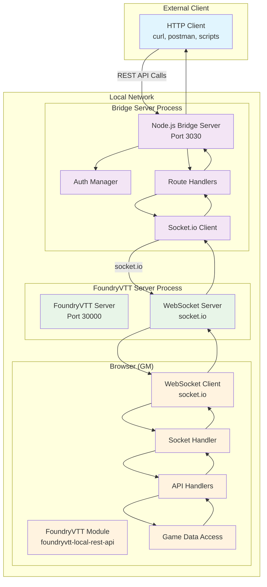
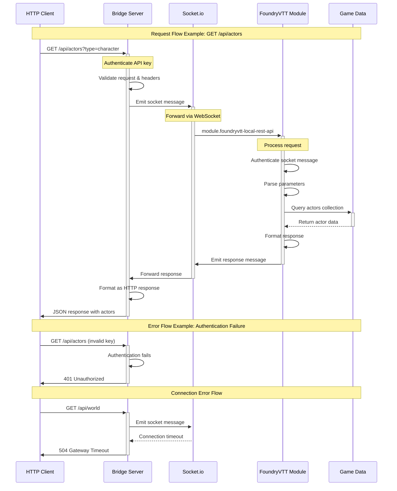
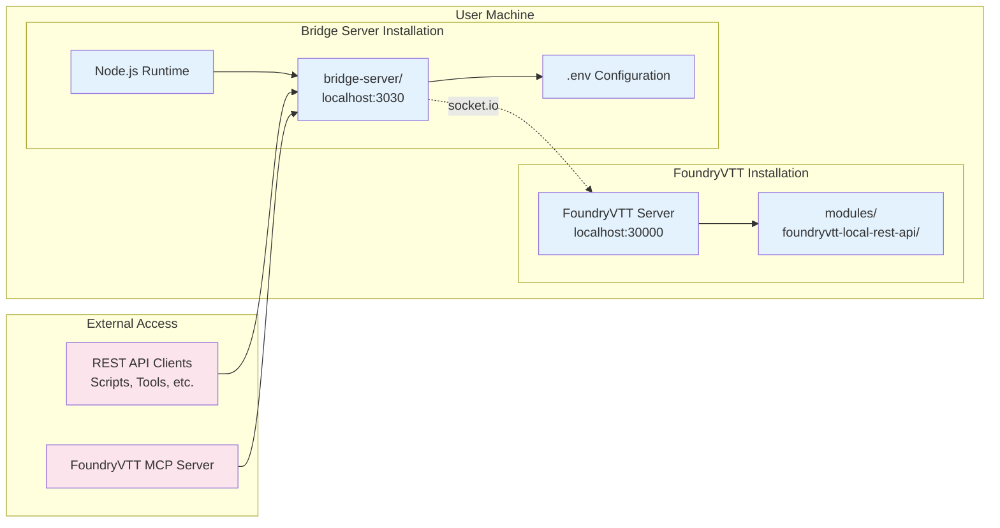
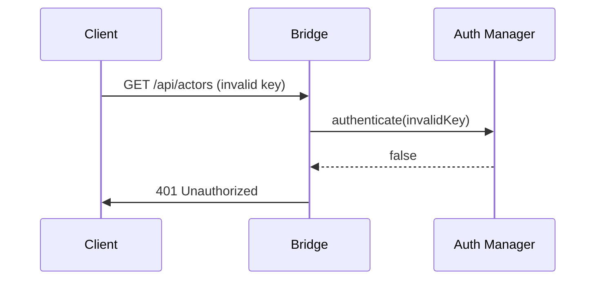
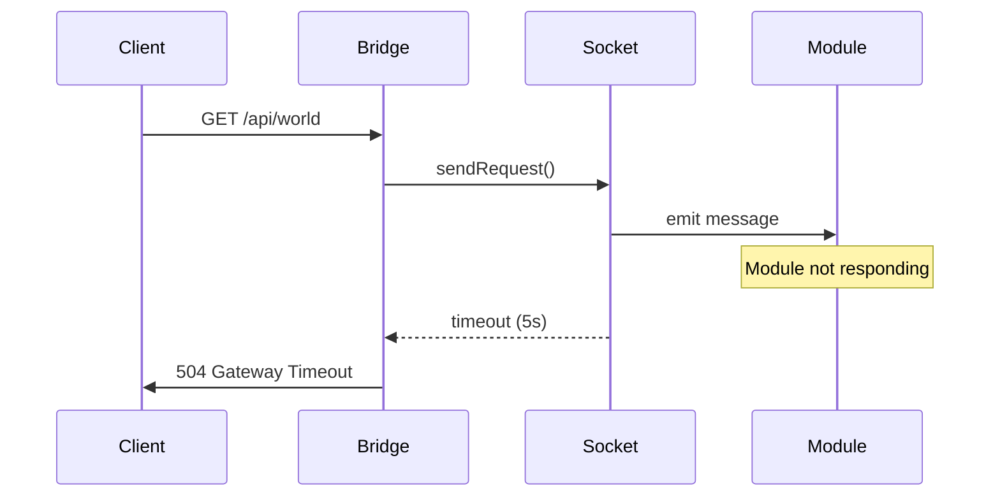
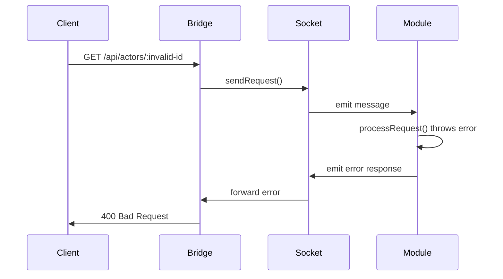
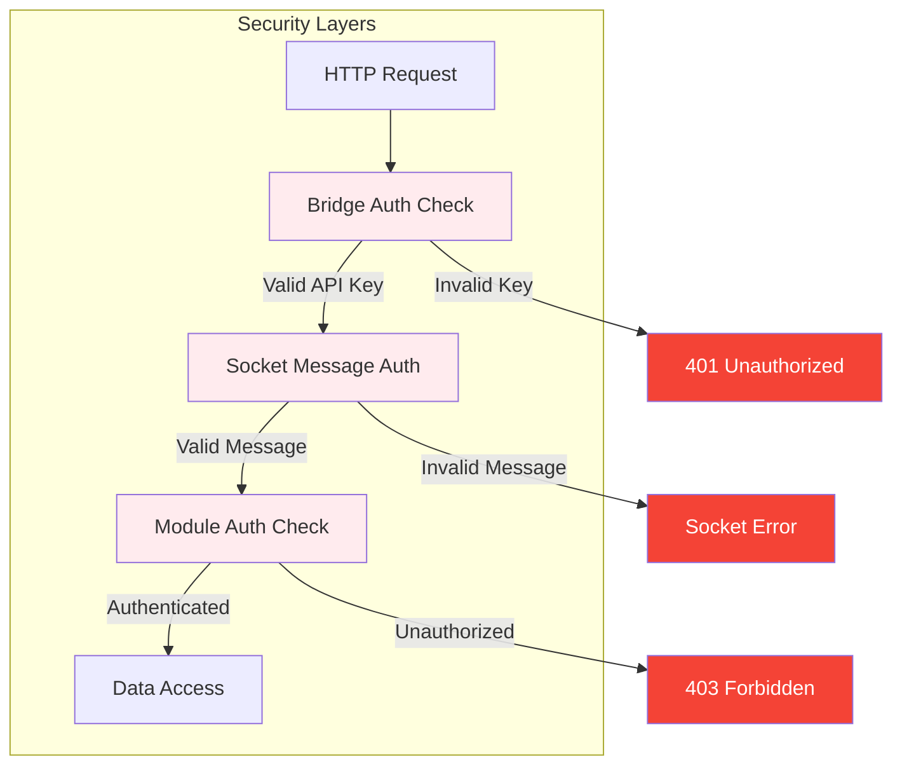
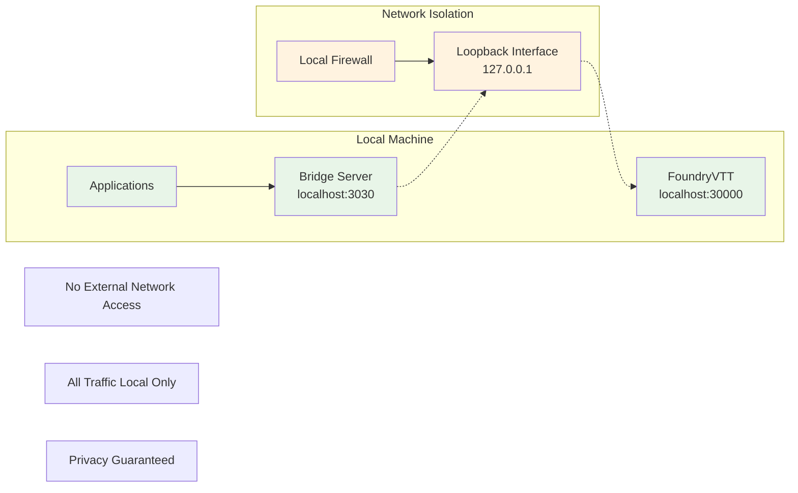
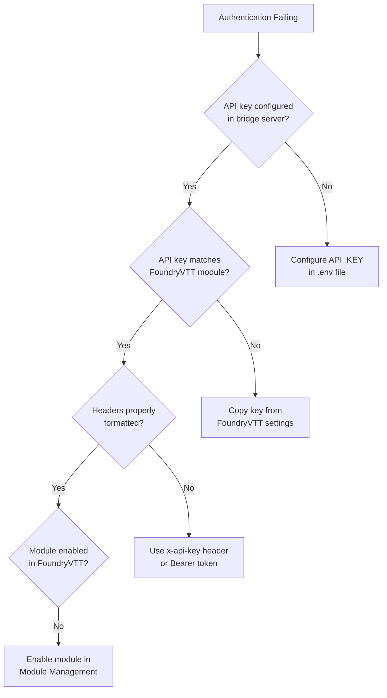

# FoundryVTT Local REST API - Detailed Architecture Documentation

## Table of Contents
- [Architecture Overview](#architecture-overview)
- [System Diagrams](#system-diagrams)
- [Component Specifications](#component-specifications)
- [Message Flow Analysis](#message-flow-analysis)
- [Technical Implementation](#technical-implementation)
- [Security Architecture](#security-architecture)
- [Deployment Patterns](#deployment-patterns)
- [Troubleshooting Guide](#troubleshooting-guide)
- [Comparison with Alternative Approaches](#comparison-with-alternative-approaches)

## Architecture Overview

The FoundryVTT Local REST API implements a **Bridge Pattern Architecture** to solve the fundamental incompatibility between FoundryVTT's client-side module system and traditional REST API requirements. This two-component system enables external HTTP access to FoundryVTT game data while respecting the platform's architectural constraints.

### Core Problem Solved

FoundryVTT modules execute in the **browser context** (client-side JavaScript), but REST APIs require **server-side HTTP endpoint creation**. Browser JavaScript cannot:
- Access Node.js HTTP server instances
- Register Express.js middleware or routes
- Create listening sockets on server ports
- Modify server-side application state

### Bridge Pattern Solution

The solution separates concerns into two specialized components:

1. **FoundryVTT Module** (Browser-side)
   - Runs within FoundryVTT's client environment
   - Handles data access and authentication
   - Communicates via socket.io messages

2. **Node.js Bridge Server** (Server-side)
   - Creates actual HTTP endpoints
   - Forwards requests via socket.io
   - Returns REST API responses

This pattern enables **local-only** REST API functionality without external dependencies or privacy concerns.

## System Diagrams

### Main Architecture Diagram



### Message Flow Diagram



### Deployment Diagram



## Component Specifications

### FoundryVTT Module Component

**Location**: `/scripts/rest-api.js`, `/scripts/socket-handler.js`  
**Runtime**: Browser (FoundryVTT client)  
**Purpose**: Socket message handling and game data access

#### Key Responsibilities
- **Authentication Management**: Validate API keys for socket messages
- **Data Access**: Query FoundryVTT collections (actors, items, scenes, etc.)
- **Message Routing**: Parse socket messages and route to appropriate handlers
- **Response Formatting**: Convert game data to JSON-compatible formats
- **Settings Management**: Handle module configuration and API key generation

#### Key Classes
```javascript
class SocketMessageHandler {
  constructor()           // Initialize API handlers
  handleMessage(data)     // Main message processing entry point
  authenticate(auth)      // Validate API key
  routeMessage(type, params, body)  // Route to handlers
  createMockRequest(params, body)   // Adapt for existing handlers
}
```

#### Configuration
- **API Key**: Cryptographically secure 256-bit key
- **Request Logging**: Optional debug logging
- **Module Settings**: Stored in FoundryVTT world settings

### Bridge Server Component

**Location**: `/bridge-server/server.js`  
**Runtime**: Node.js process  
**Purpose**: HTTP endpoint creation and request forwarding

#### Key Responsibilities
- **HTTP Server**: Create Express.js server with REST endpoints
- **Request Authentication**: Validate API keys from HTTP headers
- **Socket Communication**: Forward requests via socket.io client
- **Response Handling**: Convert socket responses to HTTP responses
- **Error Management**: Handle timeouts, connection errors, and failures

#### Key Classes
```javascript
class BridgeServer {
  constructor()           // Initialize server configuration
  start()                // Start HTTP server and connect to FoundryVTT
  setupMiddleware()      // Configure Express middleware
  setupRoutes()          // Register API endpoints
  shutdown(exitCode)     // Graceful shutdown
}

class FoundrySocketClient {
  constructor(options)    // Initialize socket client
  connect()              // Connect to FoundryVTT WebSocket
  sendRequest(endpoint, options)  // Send API request
  handleApiResponse(data)         // Process response
}
```

#### Configuration Environment Variables
- **API_KEY**: Authentication key (required)
- **FOUNDRY_URL**: FoundryVTT server URL (default: http://localhost:30000)
- **API_PORT**: Bridge server port (default: 3030)
- **REQUEST_TIMEOUT**: Socket timeout in milliseconds (default: 5000)
- **CORS_ORIGIN**: CORS origin policy (default: *)
- **LOG_LEVEL**: Logging verbosity (default: info)

## Message Flow Analysis

### Successful Request Flow

1. **HTTP Request Received**
   ```http
   GET /api/actors?type=character&limit=5
   Headers: x-api-key: abc123...
   ```

2. **Bridge Server Processing**
   ```javascript
   // Authentication
   authManager.authenticate(req.headers['x-api-key'])

   // Socket message creation
   const socketData = {
     type: 'actors.search',
     requestId: 'req_001_1642780800000',
     auth: { apiKey: apiKey },
     params: { query: { type: 'character', limit: 5 } }
   }
   ```

3. **Socket Transmission**
   ```javascript
   socket.emit('module.foundryvtt-local-rest-api', socketData)
   ```

4. **FoundryVTT Module Processing**
   ```javascript
   // Received in socket handler
   const { type, requestId, auth, params } = data

   // Authentication
   authManager.validateApiKey(auth.apiKey)

   // Route to actors handler
   await actorsAPI.searchActors(mockReq, mockRes)

   // Response creation
   return {
     requestId,
     success: true,
     data: actors
   }
   ```

5. **Response Transmission**
   ```javascript
   socket.emit('module.foundryvtt-local-rest-api.response', response)
   ```

6. **HTTP Response**
   ```http
   HTTP/1.1 200 OK
   Content-Type: application/json

   {
     "success": true,
     "data": [
       {"id": "actor1", "name": "Gandalf", "type": "character"},
       {"id": "actor2", "name": "Legolas", "type": "character"}
     ]
   }
   ```

### Error Handling Flows

#### Authentication Failure


#### Connection Timeout


#### Module Error


## Technical Implementation

### Socket.io Communication Protocol

#### Message Format Specification

**Request Message**:
```javascript
{
  type: "actors.search",           // API endpoint type
  requestId: "req_001_timestamp",  // Unique request identifier
  auth: {                          // Authentication data
    apiKey: "256-bit-hex-string"
  },
  params: {                        // Request parameters
    query: { type: "character" },
    params: { id: "actor123" }
  },
  body: { /* POST data */ }        // Request body (for POST/PUT)
}
```

**Response Message**:
```javascript
{
  requestId: "req_001_timestamp",  // Matching request ID
  success: true,                   // Success indicator
  data: { /* response data */ }    // Result data (if successful)
  // OR
  success: false,                  // Error indicator
  error: "Error Type",             // Error classification
  message: "Detailed description"  // Error details
}
```

#### Endpoint Type Mapping

| HTTP Endpoint | Socket Type | Parameters |
|---------------|-------------|------------|
| `GET /api/actors` | `actors.search` | `{ query: { type, limit, ... } }` |
| `GET /api/actors/:id` | `actors.get` | `{ params: { id } }` |
| `GET /api/items` | `items.search` | `{ query: { type, rarity, ... } }` |
| `POST /api/dice/roll` | `dice.roll` | `{ body: { formula, flavor } }` |
| `GET /api/scenes/current` | `scenes.current` | `{}` |
| `GET /api/world` | `world.info` | `{}` |

### Authentication Flow

#### API Key Generation
```javascript
// In FoundryVTT module
import { AuthManager } from './auth.js';

const authManager = new AuthManager();
const apiKey = authManager.generateApiKey(); // 256-bit cryptographic key
```

#### Validation Process
```javascript
// Bridge server validation
class AuthManager {
  authenticate(req, res, next) {
    const apiKey = req.headers['x-api-key'] ||
                   req.headers.authorization?.replace('Bearer ', '');

    if (!apiKey || !this.validateApiKey(apiKey)) {
      return res.status(401).json({
        success: false,
        error: 'Unauthorized',
        message: 'Valid API key required'
      });
    }
    next();
  }
}

// Module validation
class SocketMessageHandler {
  authenticate(auth) {
    if (!auth?.apiKey) return false;
    return this.authManager.validateApiKey(auth.apiKey);
  }
}
```

### Request/Response Adapters

#### HTTP to Socket Adaptation
```javascript
// Bridge server route
app.get('/api/actors', async (req, res) => {
  try {
    const result = await socketClient.sendRequest('/api/actors', {
      method: 'GET',
      query: req.query,
      headers: { 'x-api-key': req.headers['x-api-key'] }
    });

    res.json({
      success: true,
      data: result
    });
  } catch (error) {
    res.status(500).json({
      success: false,
      error: 'Internal Server Error',
      message: error.message
    });
  }
});
```

#### Socket to FoundryVTT Adaptation
```javascript
// Module socket handler
createMockRequest(params, body) {
  return {
    query: params.query || {},    // Express req.query
    params: params.params || {},  // Express req.params
    body: body || {}              // Express req.body
  };
}

createMockResponse() {
  let responseData = null;
  return {
    json: (data) => { responseData = data; },
    status: (code) => { /* handle status */ },
    getData: () => responseData
  };
}
```

## Security Architecture

### Authentication Security Model

#### Multi-Layer Authentication
1. **Bridge Server Layer**: HTTP header validation
2. **Socket Layer**: Message-level authentication
3. **Module Layer**: FoundryVTT session validation



#### Cryptographic Standards
- **Key Generation**: 256-bit cryptographically secure random keys
- **Validation**: Constant-time comparison to prevent timing attacks
- **Storage**: Keys stored in FoundryVTT world settings (encrypted)
- **Transmission**: Keys sent via secure HTTP headers only

#### Security Best Practices Implemented
- **No Secrets in URLs**: API keys only in headers
- **Timing Attack Prevention**: Constant-time string comparison
- **Request Logging**: Optional with privacy controls
- **Error Privacy**: No sensitive data in error messages
- **CORS Configuration**: Configurable origin restrictions

### Network Security Model

#### Local-Only Architecture


## Deployment Patterns

### Standard Local Deployment

#### Prerequisites
- FoundryVTT Server running on port 30000
- Node.js 22.12+ installed on same machine
- Network access between components

#### Installation Steps
1. **FoundryVTT Module Installation**
   ```bash
   # Copy module to FoundryVTT modules directory
   cp -r foundryvtt-local-rest-api/ ~/foundrydata/modules/

   # Enable module in FoundryVTT
   # Navigate to Module Management → Enable "FoundryVTT Local REST API"
   ```

2. **Bridge Server Setup**
   ```bash
   # Navigate to bridge server directory
   cd bridge-server/

   # Install dependencies
   npm install

   # Configure environment
   cp .env.example .env
   # Edit .env with API key from FoundryVTT module settings
   ```

3. **Start Services**
   ```bash
   # Start FoundryVTT (if not running)
   node foundry.js --dataPath=~/foundrydata

   # Start bridge server
   npm start
   ```

### Docker Deployment

#### Container Configuration
```dockerfile
# Bridge Server Dockerfile
FROM node:24-alpine

WORKDIR /app
COPY bridge-server/ .
RUN npm ci --omit=dev

EXPOSE 3030
CMD ["npm", "start"]
```

#### Docker Compose Setup
```yaml
version: '3.8'
services:
  foundry:
    image: felddy/foundryvtt:release
    ports:
      - "30000:30000"
    volumes:
      - foundry-data:/data
      - ./foundryvtt-local-rest-api:/data/modules/foundryvtt-local-rest-api

  bridge-server:
    build: ./bridge-server
    ports:
      - "3030:3030"
    environment:
      - FOUNDRY_URL=http://foundry:30000
      - API_KEY=${API_KEY}
    depends_on:
      - foundry

volumes:
  foundry-data:
```

### Development Deployment

#### Hot Reload Configuration
```bash
# FoundryVTT development mode
node foundry.js --dataPath=./dev-data --port=30001

# Bridge server with nodemon
cd bridge-server/
npm run dev  # Uses nodemon for auto-restart
```

#### Testing Environment
```bash
# Run integration tests
npm test

# Test API endpoints
curl -H "x-api-key: your-key" http://localhost:3030/api/status
```

### Production Considerations

#### Performance Optimization
- **Connection Pooling**: Reuse socket connections
- **Request Caching**: Cache frequent queries
- **Resource Limits**: Configure memory and CPU limits
- **Health Checks**: Monitor component health

#### Monitoring and Logging
```javascript
// Enhanced logging configuration
{
  "logging": {
    "level": "info",
    "format": "json",
    "destinations": [
      {"type": "console"},
      {"type": "file", "path": "./logs/bridge-server.log"}
    ]
  }
}
```

## Troubleshooting Guide

### Common Issues and Solutions

#### Issue 1: Bridge Server Cannot Connect to FoundryVTT

**Symptoms**:
- Bridge server logs show "Connection timeout"
- API requests return 504 Gateway Timeout
- Socket client connection fails

**Diagnosis**:
```bash
# Check FoundryVTT server status
curl http://localhost:30000/

# Check socket.io endpoint
curl http://localhost:30000/socket.io/

# Verify bridge server configuration
cat bridge-server/.env
```

**Solutions**:
1. **Verify FoundryVTT is running**: Check port 30000 accessibility
2. **Check firewall settings**: Ensure socket.io traffic allowed
3. **Validate FOUNDRY_URL**: Confirm correct hostname/port in .env
4. **Review FoundryVTT logs**: Look for WebSocket connection errors

#### Issue 2: Authentication Failures

**Symptoms**:
- All API requests return 401 Unauthorized
- Bridge server logs show "Invalid API key"
- Module reports authentication errors

**Diagnosis Flow**:


**Solutions**:
1. **Copy API key**: Get from FoundryVTT module settings → paste to .env
2. **Check header format**: Use `x-api-key: key` or `Authorization: Bearer key`
3. **Verify module status**: Ensure module is enabled and initialized
4. **Test authentication**: Use /api/status endpoint (no auth) first

#### Issue 3: Request Timeouts

**Symptoms**:
- Intermittent 504 errors
- Bridge server logs show "Request timeout"
- Long response times

**Performance Analysis**:
```javascript
// Monitor request timing
console.time('api-request');
const response = await fetch('/api/actors');
console.timeEnd('api-request');

// Check pending requests
curl http://localhost:3030/api/status | jq '.bridge.pendingRequests'
```

**Solutions**:
1. **Increase timeout**: Set REQUEST_TIMEOUT=10000 in .env
2. **Check FoundryVTT performance**: Large worlds may be slower
3. **Optimize queries**: Use limit parameters for large datasets
4. **Monitor system resources**: Check CPU/memory usage

#### Issue 4: Module Not Loading

**Symptoms**:
- Module appears disabled in FoundryVTT
- No socket message handlers registered
- Bridge server cannot communicate

**Debug Steps**:
```bash
# Check FoundryVTT module directory
ls ~/foundrydata/modules/foundryvtt-local-rest-api/

# Verify module.json validity
cat ~/foundrydata/modules/foundryvtt-local-rest-api/module.json | jq .

# Check FoundryVTT logs for module errors
tail -f ~/foundrydata/logs/foundry.log
```

**Solutions**:
1. **Verify file permissions**: Ensure FoundryVTT can read module files
2. **Check module.json**: Validate JSON syntax and required fields
3. **Review FoundryVTT logs**: Look for JavaScript errors during load
4. **Clear browser cache**: Force refresh of module JavaScript

### Diagnostic Tools

#### Health Check Endpoint
```bash
# Comprehensive system status
curl http://localhost:3030/api/status | jq .
```

#### Debug Logging
```javascript
// Enable detailed logging
// In bridge-server/.env
LOG_LEVEL=debug

// In FoundryVTT module settings
"Log API Requests" = true
```

#### Connection Testing
```bash
# Test WebSocket connectivity
node -e "
const io = require('socket.io-client');
const socket = io('http://localhost:30000');
socket.on('connect', () => console.log('Connected:', socket.id));
socket.on('error', err => console.error('Error:', err));
"
```

## Comparison with Alternative Approaches

### Why Not Direct HTTP Server in Module?

#### Attempted Approach (Impossible)
```javascript
// This code CANNOT work in FoundryVTT modules
const express = require('express');  // ❌ Not available in browser
const app = express();
const server = game.socket.socket.io.httpServer;  // ❌ Undefined property

app.get('/api/actors', (req, res) => {  // ❌ Never registered
  res.json(game.actors.contents);
});
```

#### Why It Fails
- **Browser Context**: Modules run in browser, not Node.js
- **No Express**: Express.js not available in browser environment
- **No Server Access**: Cannot access or modify FoundryVTT's HTTP server
- **Security Restrictions**: Browser cannot open server ports

#### Bridge Pattern Advantages
✅ **Works Within Constraints**: Respects FoundryVTT architecture  
✅ **Local-Only**: No external dependencies  
✅ **Full REST API**: Complete HTTP endpoint functionality  
✅ **Secure**: Proper authentication and error handling  
✅ **Maintainable**: Clear separation of concerns  

### Comparison with Other Patterns

#### Service Worker Pattern
```javascript
// Register service worker for request interception
navigator.serviceWorker.register('/api-worker.js');

// Limited capabilities:
// ❌ Same-origin requests only
// ❌ Cannot bind to arbitrary ports
// ❌ Limited browser support
// ❌ Complex setup and debugging
```

#### Browser Extension Pattern
```javascript
// Chrome extension with native messaging
chrome.runtime.sendNativeMessage('foundry-api', request);

// Challenges:
// ❌ Requires separate extension installation
// ❌ Browser-specific implementation
// ❌ Complex permission management
// ❌ Not cross-platform
```

#### WebRTC Data Channels
```javascript
// Peer-to-peer communication
const connection = new RTCPeerConnection();
const channel = connection.createDataChannel('api');

// Limitations:
// ❌ Complex signaling setup
// ❌ Not REST-compatible
// ❌ Browser compatibility issues
// ❌ Firewall/NAT problems
```

### Bridge Pattern Benefits Summary

| Aspect | Bridge Pattern | Direct HTTP | Service Worker | Browser Extension |
|--------|----------------|-------------|----------------|-------------------|
| **Feasibility** | ✅ Works | ❌ Impossible | ⚠️ Limited | ⚠️ Complex |
| **REST Compatibility** | ✅ Full | ❌ N/A | ⚠️ Partial | ✅ Full |
| **Local-Only** | ✅ Yes | ❌ N/A | ✅ Yes | ✅ Yes |
| **Cross-Platform** | ✅ Yes | ❌ N/A | ⚠️ Partial | ❌ No |
| **Setup Complexity** | ⚠️ Moderate | ❌ N/A | ❌ High | ❌ High |
| **Maintainability** | ✅ Good | ❌ N/A | ⚠️ Poor | ⚠️ Moderate |
| **Performance** | ✅ Good | ❌ N/A | ✅ Good | ✅ Good |
| **Security** | ✅ Strong | ❌ N/A | ⚠️ Limited | ✅ Strong |

### Migration Path from Other Solutions

#### From FoundryVTT-MCP Integration
```javascript
// Before: External API dependency
const foundryMCP = new FoundryMCPServer({
  apiUrl: 'https://external-service.com/foundry',
  useRestModule: true  // Hoped module would work
});

// After: Local bridge pattern
const foundryMCP = new FoundryMCPServer({
  apiUrl: 'http://localhost:3030',
  useRestModule: false  // Use local bridge
});
```

#### Configuration Migration
```bash
# Update environment variables
# From:
FOUNDRY_API_URL=https://external-api.com/foundry
USE_REST_MODULE=true

# To:
FOUNDRY_API_URL=http://localhost:3030
USE_REST_MODULE=false
API_KEY=your-local-api-key
```

The bridge pattern provides the optimal solution for FoundryVTT's architectural constraints while maintaining the desired REST API functionality, security, and local-only operation.
